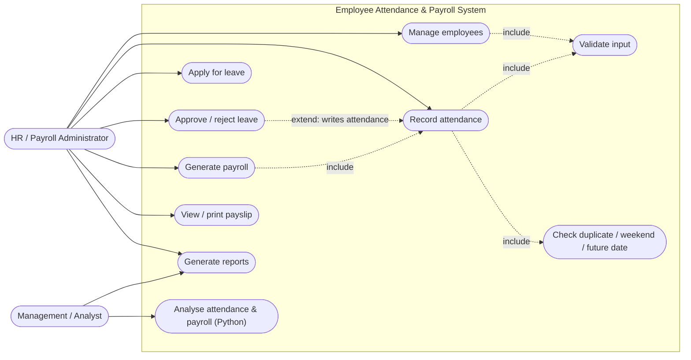
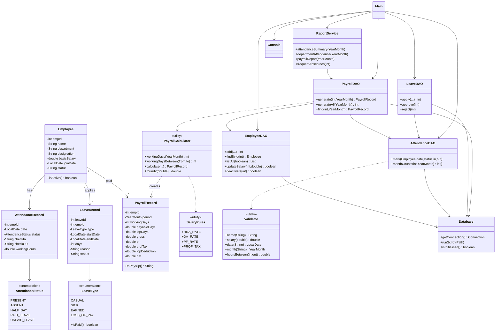
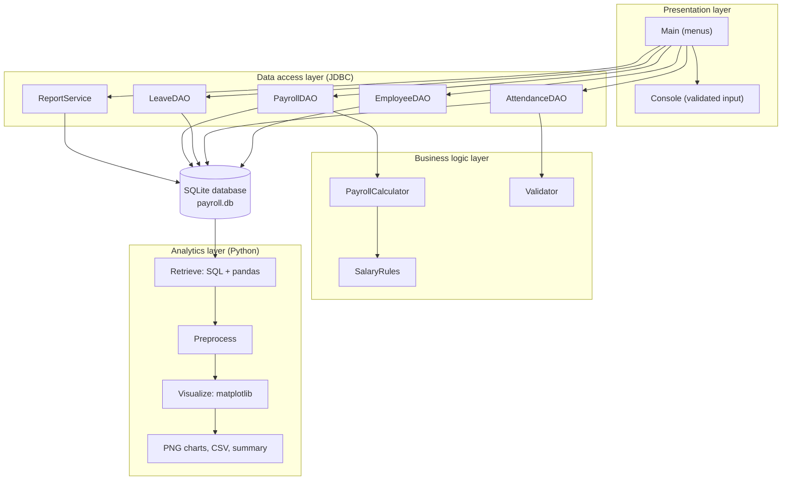
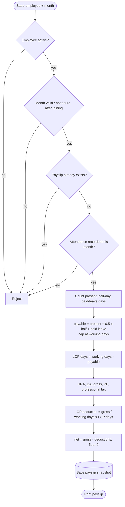

# System Design

Diagrams are written in Mermaid; GitHub renders them automatically.

## 1. Use Case Diagram



| Use case | Description |
|---|---|
| Manage employees | Add, view, search, update salary/department/designation, deactivate |
| Record attendance | Present / Absent / Half-Day with check-in and check-out |
| Apply for leave | Casual, Sick, Earned or Loss of Pay for a date range |
| Approve / reject leave | Approval creates Paid/Unpaid Leave attendance rows |
| Generate payroll | One employee or all, for a month, using salary rules |
| Generate reports | Attendance summary, department attendance, payroll, absentees, leave |
| Analyse (Python) | Retrieve, preprocess and visualize data |

## 2. Class Diagram



## 3. System Architecture



**Layers:** presentation (console menus and validated input), business logic (pure, unit-tested payroll and validation), data access (one DAO per aggregate, prepared statements only), database (SQLite with constraints), analytics (independent Python pipeline reading the same database).

## 4. Payroll generation flow



## 5. Leave approval sequence

```mermaid
sequenceDiagram
    actor Admin
    participant Main
    participant LeaveDAO
    participant AttendanceDAO
    participant DB
    Admin->>Main: Approve leave #id
    Main->>LeaveDAO: approve(id)
    LeaveDAO->>DB: load leave, check status = Pending
    LeaveDAO->>DB: BEGIN
    loop each working day in range
        LeaveDAO->>AttendanceDAO: exists(emp, day)?
        AttendanceDAO->>DB: SELECT
        LeaveDAO->>AttendanceDAO: insert Paid/Unpaid Leave
        AttendanceDAO->>DB: INSERT
    end
    LeaveDAO->>DB: UPDATE leave status = Approved
    LeaveDAO->>DB: COMMIT (ROLLBACK on any failure)
    LeaveDAO-->>Main: done
    Main-->>Admin: "Leave approved; attendance updated"
```
